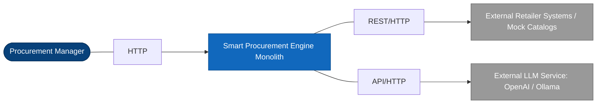
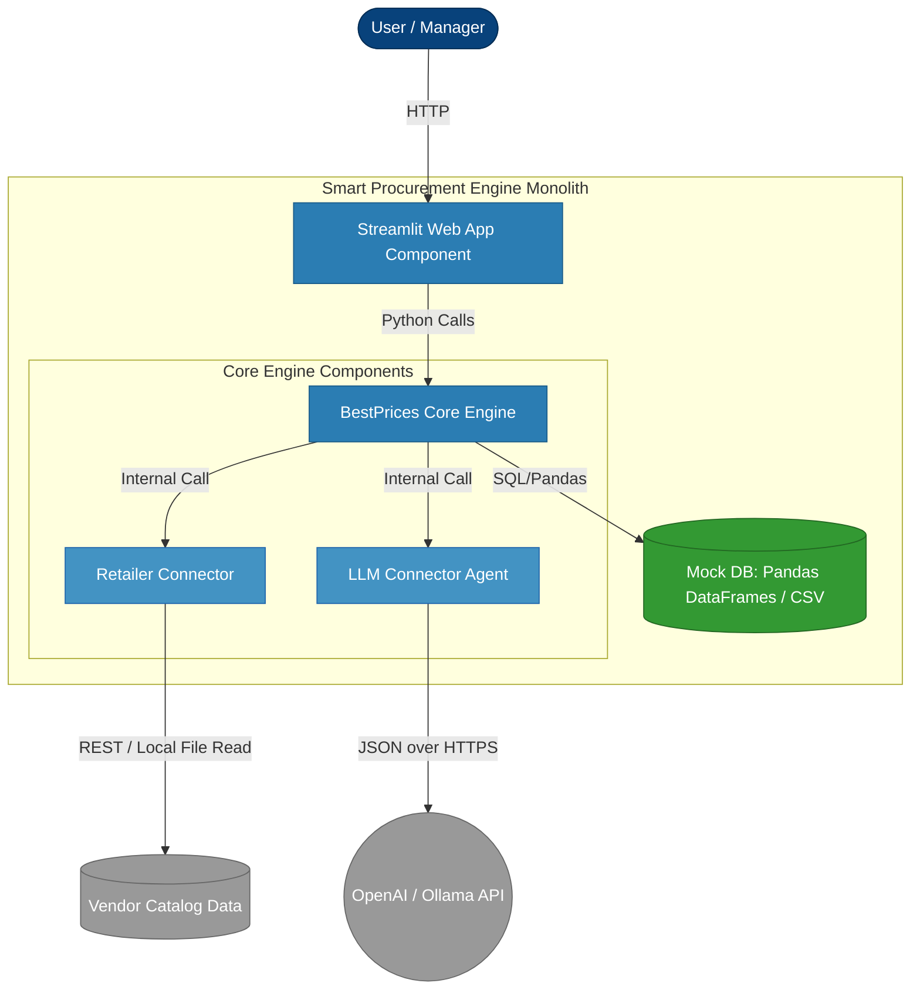

# C4 Architectural Specification & Roadmap

This document defines the system architecture using the C4 Model approach (Level 1: System Context, Level 2: Containers) and maps out the implementation steps.

---

## 1. C4 Level 1: System Context
Defines the boundaries of the Smart Procurement Engine and how users and external systems interact with it.

### Context Elements:
*   **User:** Enters text procurement requests, uploads custom files, and receives optimal purchasing recommendations.
*   **Smart Procurement Engine:** The core system under development. Processes text, queries inventory, and optimizes baskets.
*   **Retailer Systems:** External endpoints providing product catalogs, stock levels, and real-time prices.
*   **LLM Service:** External AI model used for structural NLP parsing and fuzzy catalog matching.

---

## 2. C4 Level 2: Containers
Defines the internal high-level technical blocks of the monolith application and the data schema logic.

### Container Responsibilities:
1.  **Streamlit Web App:** Presentation layer. Form for user prompt entry, file upload buttons, and tables showing results.
2.  **BestPrices Core Engine:** Orchestration layer. Controls execution flow: receives query -> calls LLM -> searches prices -> matches entities -> optimizes.
3.  **Mock DB (CSV/Pandas):** Storage layer. Holds local tables: `Users`, `User_Requests`, and cache of `Retailer_Prices`.
4.  **Retailer Connector:** Integration block. Reads vendor data formats and normalizes them.
5.  **LLM Connector Agent:** Intelligence block. Manages prompt templates, chat history, and schemas for data structure enforcement.
