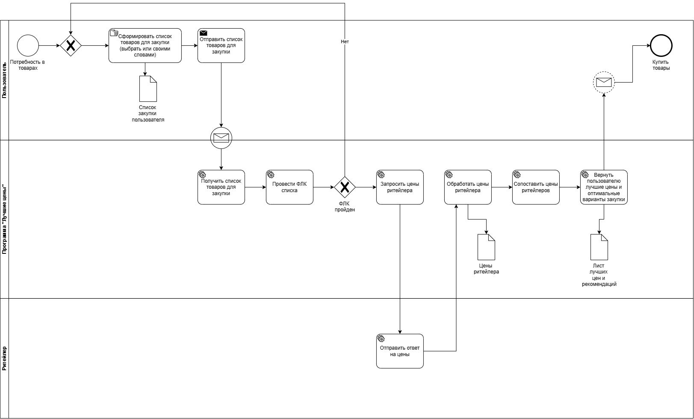

# Smart Procurement Engine (AI-Powered Price Monitor)

A modular monolith system designed to optimize corporate and personal procurement. The application analyzes natural language user requests, extracts required goods using Generative AI (LLM), matches them with diverse retailer catalogs, and identifies the most cost-effective sourcing options.

---

## System Architecture (C4 Model Approach)

Below is the architectural design of the system, showcasing the context, core containers, and internal components.

### 1. Architectural Strategy
* **Modular Monolithic Design:** Built with a clean separation of concerns to allow seamless microservices decomposition in the future.
* **Synchronous Integration:** To maintain simplicity for the MVP stage, communication between components is handled synchronously (gRPC/REST) without introducing heavy message brokers.

### 2. High-Level Core Containers
* **User:** Procurement manager entering text queries (e.g., "Need 5 laptops with SSD, budget $800 each").
* **API Gateway:** Single entry point for routing, rate limiting, and request validation.
* **BestPrices Core:** The main backend engine managing business logic, data transformation, and price optimization algorithms.
* **BestPrices DB (PostgreSQL):** Relational storage for user management, historical requests, catalog mappings, and cached price lists.
* **Retailer System (External):** External retail network endpoints or local data sources providing raw inventory.
* **LLM Service (External):** Generative AI API (OpenAI/Ollama) used for NLP parsing and intelligent entity matching.

### 3. Internal Components (BestPrices Core)
* **BestPrices Core:** Coordinates the main workflow (Request -> AI Parsing -> Price Search -> Optimization -> Recommendation Output).
* **Retailer Connector:** Encapsulates integration logic with various vendor platforms, converting diverse API schemas into unified inner data models.
* **LLM Connector:** Isolates prompt engineering, manages client connections, and enforces strict JSON output contracts from the language model.
